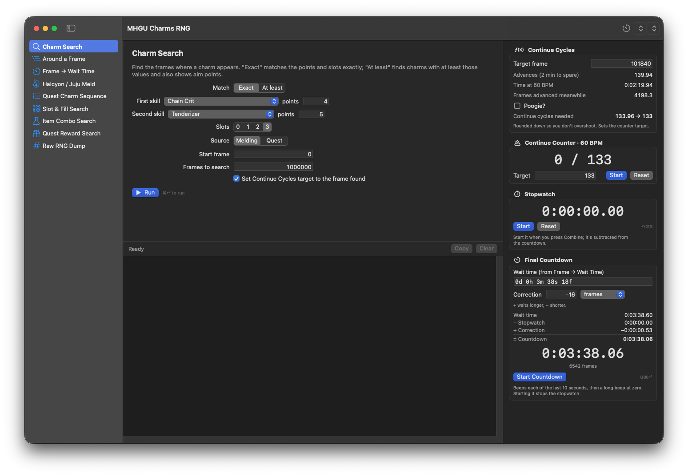
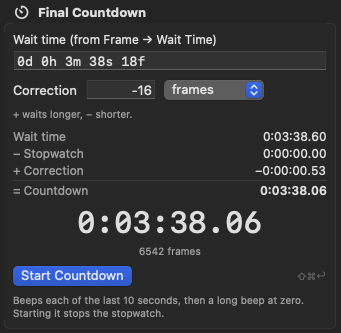

# MHGU Charms RNG

A native macOS app for charm RNG sniping in Monster Hunter Generations Ultimate (MHXX). It finds the frame a charm appears on, converts it to a wait time, and includes timers for the continue-cycle and final countdown steps. No Python, Colab or Jupyter needed.




## Based on

This app is a Swift port of the RNG analysis tool from:

- **[apmnnn/mhxx-rng](https://github.com/apmnnn/mhxx-rng)**: the original MHXX RNG research and Python notebook (MIT License). All of the RNG and charm-generation logic comes from this project.
- **[jasmithc/mhgu-rng](https://github.com/jasmithc/mhgu-rng)**: the English translation of mhxx-rng, including the documentation and English skill names.

For how charm generation and sniping work, step by step, read the guides in those repositories. Examples include [sniping using item combinations](https://github.com/jasmithc/mhgu-rng/blob/main/docs/combo_snipe.md) and the [function reference](https://github.com/jasmithc/mhgu-rng/blob/main/docs/functions.md).

## Further reading

**Learning to snipe**
- [How to Charm Snipe in Monster Hunter Generations Ultimate!](https://www.youtube.com/watch?v=6aXJoX2hKOI) (video, Clobincole): a good introduction to the whole process if you're new to charm sniping.
- [Sniping using item combinations](https://github.com/jasmithc/mhgu-rng/blob/main/docs/combo_snipe.md) (mhgu-rng docs): the method the *Item Combo Search* tool and the snipe timer are built around.

**Choosing a charm to snipe**
- [Charm Skill Tables](https://mhgu.kiranico.com/charms) (Kiranico): for each charm kind (Enduring, Timeworn, Shining, Mystery), which skills can roll in slot 1 and slot 2, with their point ranges. Check this before searching to see what's possible.
- [MHGU Skill List](https://mhgu.kiranico.com/skill) (Kiranico) and [MHGU Skills](https://monsterhunterwiki.org/wiki/MHGU/Skills) (Monster Hunter Wiki): every skill tree, and how many points each skill needs.
- [Athena's Armor Set Search for MHGU](https://monsterhunterwiki.org/wiki/Tools) (listed on the Monster Hunter Wiki's Tools page): a Windows armor set searcher. Add a charm you could snipe to see which builds it unlocks. It's a third-party program not affiliated with this project, so download it at your own discretion.

## Download

1. Download `MHGU-Charms-RNG-<version>-macOS.zip` from the [latest release](https://github.com/jasmithc/mhgu-rng-app/releases/latest). It runs on Apple Silicon and Intel Macs with macOS 14 or later.
2. Double-click the zip to unpack it, then drag **MHGU Charms RNG** into your Applications folder.
3. **The first time you open it**, macOS will warn that it can't check the app for malicious software. The app isn't signed with a paid Apple Developer ID, so macOS shows this warning for any app downloaded this way. To open it:
   - Try to open the app once and close the warning.
   - Go to **System Settings → Privacy & Security**, scroll down, and click **Open Anyway** next to "MHGU Charms RNG".
   - Confirm, and after that it opens normally.

## Build from source

```bash
./build_app.sh
open "dist/MHGU Charms RNG.app"
```

Requires macOS 14+ and the Xcode command-line tools. `./build_app.sh --universal` builds for both Apple Silicon and Intel and also makes the release zip.

## Tools

| Sidebar tool | What it does | Original function |
|---|---|---|
| Charm Search: Exact / At least | Find the frames where a charm appears (*At least* also shows aim points). The **God charms** presets menu fills in top charms for each Blademaster and Gunner weapon, and the search warns (and doesn't run) if the charm you entered can't exist. | `search()` / `search_greater()` |
| Around a Frame | List every charm near a frame | `around()` |
| Frame → Wait Time | Convert frames to `Xd Xh Xm Xs Xf` | `watch()` |
| Halcyon / Juju Meld | Charms a Halcyon or Juju meld gives | `halcyonpush()` / `jujupush()` |
| Quest Charm Sequence | Run of quest-reward charms from a frame | `sequence_charm()` |
| Slot & Fill Search | Charms with a given fill value and slot count | `search_fill_slot()` |
| Item Combo Search | Find your RNG position from item combinations, with a [reliability and stutter check](#item-combo-search-checks) | `search_combo()` |
| Quest Reward Search | Find your RNG position from quest rewards | `search_reward()` |
| Raw RNG Dump | Raw RNG state values | `allpush()` |

The toolbar picks the charm kind (Enduring, Timeworn, Shining or Mystery) and the language (English, 日本語, 中文).
**Settings (⌘,)** holds whether to show rarity, whether to show aim points for every meld rank, and the quest charm count. Run a tool with ⌘↩ and stop it with Esc.

### Item Combo Search checks

After the search, Item Combo Search adds two checks that the original tool doesn't have:

- **Reliability:** it shows how likely a random frame is to match your sequence, and warns if a chance match is likely in the range you searched. Short sequences over a large range can match a random far-away frame, so enter every value up to the 99, or search a narrower range around where you expect to be.
- **Frame stutters:** holding Combine normally gives one combination every 5 frames, but the rhythm can slip by a frame near the start. Then even a correctly read sequence has no exact match. If that happens, the search looks for a match where the combinations before one point came 1–2 frames early or late. It reports the frame and where the stutter was. The frame is based on the steady part after the stutter and still counts every value, so don't delete values to force a match.

## Snipe Timer (right-side panel)

Show or hide the panel with the timer button in the toolbar (⌥⌘T). Every control is also in the **Timer** menu. The timers keep running when the panel is hidden, and the Mac stays awake while the counter or countdown runs.

- **Continue Cycles**: enter the target frame, or turn on *Set Continue Cycles target to the frame found* in Charm Search to fill it in from the first result. It calculates:
  - `(T − 3600) / 702` advances with 2 minutes to spare
  - the time those take at your pace (60 BPM unless you change it in the counter)
  - the frames advanced meanwhile (`minutes × 1800`)
  - the cycles needed, `(T − 3600 − frames advanced) / 702`

  The result is rounded down and becomes the counter target. Turn on **Poogie?** (⌥⌘P) if Poogie is in your room: it takes 5 cycles off, leaving time to remove Poogie.

  <p align="center">
    
  </p>

- **Continue Counter** (⌥⌘C): beeps at your chosen pace, counting 1 → target, with a higher, longer beep on the last count. Set the pace under **Pace** (30–240 BPM, default 60); the Continue Cycles calculator uses the same pace. A faster pace means less waiting, but **90 BPM is the fastest that has proved reliable**: above that, the next screen sometimes hasn't finished loading when you press B, so the press is missed and the following A press confirms instead. The app shows a warning above 90. When trying a new pace, check that every press counted by confirming your position with Item Combo Search.

  <p align="center">
    
  </p>

- **Stopwatch** (⇧⌘S): start it when you press Combine.

  <p align="center">
    
  </p>

- **Final Countdown** (⇧⌘↩): countdown = wait time − stopwatch + correction.
  - Running *Frame → Wait Time* fills in the wait time. You can also type `0d 1h 40m 6s 15f` or a frame count.
  - Enter the correction in seconds or frames (+ waits longer, − shorter).
  - Starting the countdown freezes the stopwatch.
  - It beeps on each of the last 10 seconds, then plays a long beep at zero.

  <p align="center">
    
  </p>

## English skill names

The app uses one name for each skill, whichever slot it's in. Two changes from mhgu-rng's English names:

- Deviant skills are labelled **"… Soul"** and their 真 versions **"… Soul X"**. For example, *Deadeye Soul* (隻眼) is a different skill from the gunner skill *Dead Eye* (射法), and the old labels made them easy to confuse. "C.beard" is now "Crystalbeard Soul".
- The typo "Reaload Spd" is now "Reload Spd".

## Development

Want to help, or build a Windows or Linux version? See [CONTRIBUTING.md](CONTRIBUTING.md). The engine already builds and passes its tests on macOS, Linux and Windows.

- `Sources/RNGCore`: Swift port of the original notebook's RNG and charm logic, plus the snipe-timer maths. Cross-platform.
- `Sources/MHXXRNG`: the SwiftUI app (macOS only).
- `Sources/rngcheck`: command-line harness used by `tools/compare.py`.
- `Tests/RNGCoreTests`: unit tests, run with `swift test`.

`Sources/RNGCore/Tables.swift` (skill and charm tables) is generated from the original notebook. To regenerate it, or to check the Swift engine against the Python code, get `mhxx-rng.ipynb` from [jasmithc/mhgu-rng](https://github.com/jasmithc/mhgu-rng) and pass its path:

```bash
python3 tools/gen_tables.py path/to/mhxx-rng.ipynb
```

```bash
swift build -c release && python3 tools/compare.py path/to/mhxx-rng.ipynb
```

`compare.py` runs 28 cases through both implementations and checks that the output is identical.

The app icon is generated from the pixel art in `Resources/AppIcon-source.png`. To change the art or the tile colour (`ice`, `slate` or `sand`), regenerate it with:

```bash
swift tools/make_icon.swift Resources/AppIcon-source.png Resources/AppIcon.icns ice
```

## License

MIT. See [LICENSE](LICENSE), which keeps the original mhxx-rng copyright notice.
